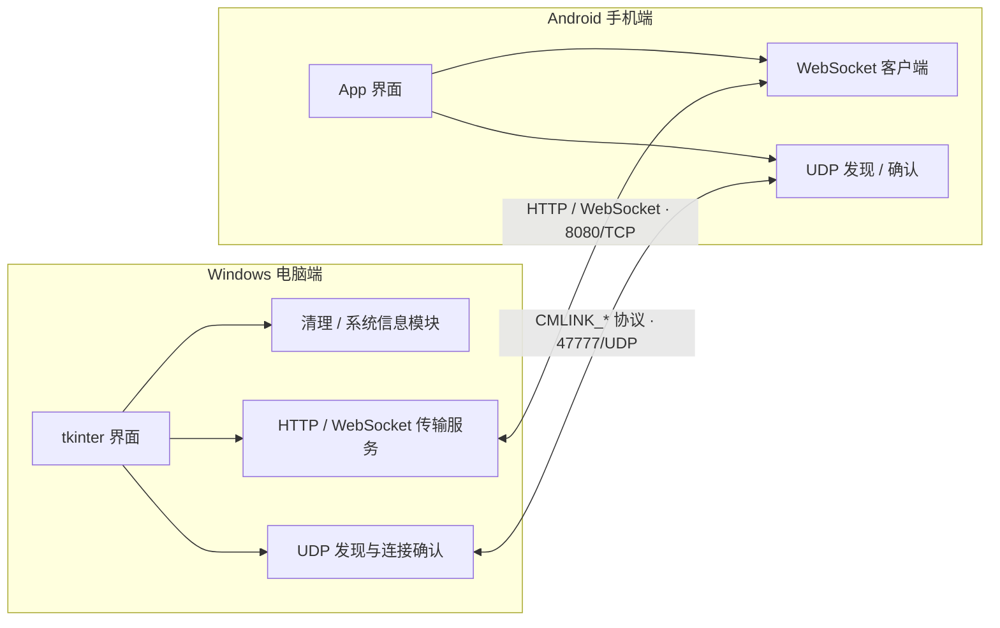

# 合枢 HS

> 一机中枢，设备无界。

**合枢 HS** 是一款面向 Windows 的电脑清理与设备互联工具：既能扫描并清理系统垃圾、排查硬件与网络问题，也能把电脑变成手机的文件 / 文字中转站。手机端提供原生 Android App，在同一 Wi-Fi 下通过「设备列表 + 双方确认」建立连接；不在同一网络时可使用手动地址 + 配对码。


---

## 下载安装

前往 [Releases](https://github.com/H-S-10086/heshu-hs/releases/latest) 下载最新版：

| 平台 | 文件 | 说明 |
| --- | --- | --- |
| Windows 10/11 | [HeShu-HS-Setup-2.1.0.exe](https://github.com/H-S-10086/heshu-hs/releases/download/v2.1.0/HeShu-HS-Setup-2.1.0.exe) | 电脑端安装包（内部已附带手机 APK） |
| Android 7.0+ | [CleanMasterLink.apk](https://github.com/H-S-10086/heshu-hs/releases/download/v2.1.0/CleanMasterLink.apk) | 手机 App 1.8.2，覆盖安装即可 |

安装步骤：

1. 双击 Windows 安装包完成安装，从开始菜单启动「合枢 HS」。
2. 把 APK 传到手机安装（数据线、网盘或电脑端「手机互传」都可以）。
3. 电脑打开「设备协同」→「开启协同服务」；手机打开 App →「搜索设备」→ 选择电脑 → 在电脑上点「允许」。

SHA-256 校验值：

- `HeShu-HS-Setup-2.1.0.exe`：`47ab4edcb768c5fb60b51631e2292ce130aa6a722dab58f17b8a3aca2f108413`
- `CleanMasterLink.apk`：`4cd44f56af416858a2f83a8e465678eca1290845cc2c027d5e83b944e5ca1d71`

---

## 功能特性

### 电脑端（Python + tkinter）

- **垃圾清理**：常规垃圾、深度清理、系统大文件、微信 / QQ 专清、隐私清理，每项标注来源，支持白名单与清理前还原点。
- **系统维护**：注册表清理、启动项管理、软件卸载与安装包压缩、大文件搬家、磁盘碎片整理、虚拟内存转移、弹窗拦截、驱动与虚拟设备诊断。
- **系统信息**：硬件总览、实时占用与温度、硬盘健康（SMART / TRIM）、网络测速与连通性诊断。
- **设备互联**：PC ↔ 手机双向文字与文件、手机之间经电脑中转互发、多台手机同时连接、实时麦克风、剪贴板同步、通知转发。

### 手机端（原生 Android）

- 微信式会话气泡，按设备名区分「我 / 💻 电脑 / 📱 其它设备」。
- 长文本输入支持内部滚动与全屏编辑。
- 同一 Wi-Fi 自动发现电脑，选中后由电脑确认再连接。
- 电脑请求连接时手机弹窗确认，连接结果实时提示。
- 断开 / 被断开后立即停止收发，旧凭据同时失效。

## 架构



- **同一 Wi-Fi**：UDP 广播互相发现 → 列表选择 → 对方弹窗同意 → 电脑签发一次性 token → WebSocket 建立长连接。
- **不同网络**：手动填写公网 / IPv6 地址 + 电脑上显示的 6 位配对码；可选 UPnP 自动端口映射或 ZeroTier / Tailscale 组网。
- **断开语义**：手机主动退出发送 `bye`，电脑右键断开发送 `kick`，两者都会立即吊销 token，HTTP / WebSocket 请求随即失效。

## 目录结构

```text
.
├── main.py                 # 程序入口与主界面
├── scanner.py              # 垃圾扫描
├── cleaner.py              # 清理执行
├── registry_cleaner.py     # 注册表清理
├── hardware_info.py        # 硬件信息
├── network_tools.py        # 网络工具
├── file_transfer.py        # HTTP / WebSocket 传输服务
├── link_service.py         # 设备发现、配对与连接确认
├── upnp_nat.py             # UPnP 自动端口映射（跨网络）
├── page_*.py               # 各功能页面
├── installer.iss           # Inno Setup 安装脚本
├── android/                # 手机端原生工程（无 Gradle）
│   ├── src/                # Java 源码
│   ├── res/                # 资源
│   ├── AndroidManifest.xml
│   └── build_apk.py        # 手工 APK 构建脚本
└── .github/                # Issue / PR 模板
```

## 快速开始

### 运行电脑端

要求：Windows 10/11 x64、Python 3.10+。程序只使用标准库，无需安装第三方依赖。

```bash
python main.py
```

> 清理硬盘、注册表等功能需要管理员权限；首次运行建议从源码启动观察行为。

### 打包 Windows 安装包

```bash
pip install pyinstaller
python -m PyInstaller "C盘清理大师.spec" --noconfirm
python android/build_apk.py --clean
```

确认 `dist\C盘清理大师.exe` 与 `android\CleanMasterLink.apk` 存在后，用 [Inno Setup 6](https://jrsoftware.org/isinfo.php) 编译：

```bash
ISCC.exe installer.iss
```

### 构建 Android App

要求：

- JDK 17（设置 `JAVA_HOME`）
- Android SDK Platform 34 与 Build-Tools 34.0.0（设置 `ANDROID_SDK_ROOT` 或 `ANDROID_HOME`）

```bash
python android/build_apk.py --clean
```

产物为 `android/CleanMasterLink.apk`。首次构建会自动生成开发用签名密钥 `android/cleanmaster.keystore`，**该文件已被 `.gitignore` 排除，请勿提交**。发布自己的构建时可通过环境变量 `HS_KS_PASS` / `HS_KS_ALIAS` 指定口令与别名。

## 使用说明

1. 打开电脑端「设备协同」页，点击「开启协同服务」。
2. 手机打开 App，点「搜索设备」；同一 Wi-Fi 下会列出这台电脑。
3. 手机选中电脑后，电脑端弹窗确认；允许后自动建立连接。
4. 也可以在电脑端「可连接的设备」里选中手机发起请求，由手机弹窗确认。
5. 不在同一网络时：电脑勾选「允许跨网络访问」并设置数字访问码，手机手动输入公网 / IPv6 地址，再输入电脑上的 6 位配对码。

断开后需要重新走一次「选设备 + 对方同意」，旧 token 无法继续收发消息。

接收目录在「手机互传」页选择后会立即保存，下次打开或重启程序都会沿用；如需恢复默认，重新选择 `Downloads\C盘清理大师接收` 即可。

手机锁屏后要保持连接与麦克风，请在 App 首页点「后台保活设置」，允许忽略电池优化，并在系统设置中允许自启动/后台运行。部分手机还需要在最近任务里锁定本应用。

### 扫码配对与无 Wi-Fi 连接

- 电脑端「手机互传」页点「📱 App 扫码配对」，选择手机能访问的网段地址后，用手机系统相机扫码即可自动配对；相机不能直接打开 App 时，手动输入弹窗里的地址和配对码。
- 没有 Wi-Fi 时，手机端点「连接方式」，可选择 USB 网络共享、手机热点或蓝牙 PAN；建立连接后回到 App 点「自动发现」。
- 电脑端「🌐 所有地址」会列出全部网卡地址，USB 网络共享 / 热点 / 蓝牙 PAN 建好后选择对应网段即可。

## 通信协议

| 通道 | 端口 | 用途 |
| --- | --- | --- |
| UDP 广播 | 47777 | 设备发现、连接请求 / 同意 / 拒绝、token 下发 |
| HTTP | 8080（可自动避让） | 文件上传下载、文字消息、会话列表 |
| WebSocket | 8080 | 实时消息、剪贴板、通知、手机麦克风音频 |

局域网内的连接请求只接受私有地址来源；公网访问默认关闭，开启后仍需访问码或配对 token。

## 安全设计

- 默认只允许局域网访问，跨网络访问需要显式开启并设置数字访问码。
- App 请求必须携带有效 token（走 `X-Transfer-Token` 请求头，不出现在 URL）；token 30 天过期。
- 电脑端「已配对设备」可查看并移除配对记录，移除后立即踢掉在线连接。
- 断开 / 被断开时 token 立即吊销；Android 关闭 `allowBackup`，避免备份导出凭据。
- 微信 / QQ 专清按版本识别目录：AppData 配置目录只提示不删除，消息库 `nt_db`
  永不触碰，已接收文件默认不清理。
- 释放量按实际删除成功的字节统计，被占用的文件会提示"跳过"；计划任务默认只清系统垃圾。
- 上传文件名做安全清洗，杜绝路径穿越；上传大小可配置上限。
- 手机麦克风只做实时传输，不落盘；录音期间有常驻红色提示与通知。
- 不依赖任何云端中转，数据只在设备之间直接传输。

## 参与贡献

欢迎提交 Issue 与 Pull Request。开始之前请阅读：

- [CONTRIBUTING.md](CONTRIBUTING.md)
- [CODE_OF_CONDUCT.md](CODE_OF_CONDUCT.md)
- [SECURITY.md](SECURITY.md)

## 更新日志

见 [CHANGELOG.md](CHANGELOG.md)。

## 许可证

本项目基于 [MIT License](LICENSE) 开源。

## 免责声明

清理类功能可能删除文件或修改系统设置，属于不可逆操作。请在使用前备份重要数据，并在理解每项操作含义后再执行。因使用本软件造成的任何数据丢失或系统问题，作者不承担责任。
